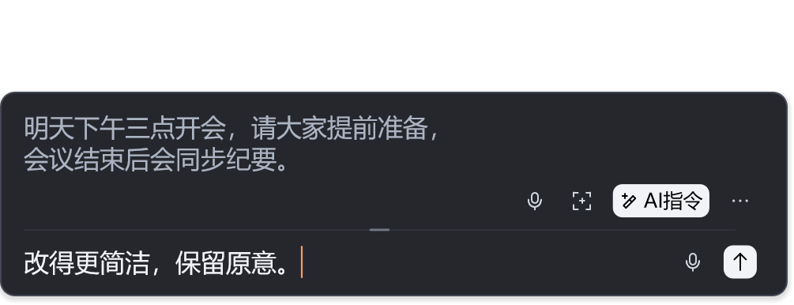
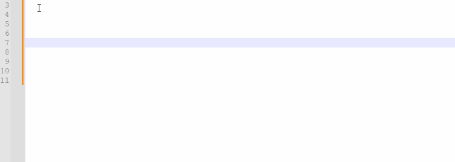

<div align="center">


# 松果输入法 SongGuo

**先把话写好，再顺手发出。**

中文输入 · 文字暂存 · AI 写作 · 语音 · 实时翻译

[**下载预览版**](https://github.com/sxzxs/Real-time-translation-typing/releases)　 · 　[访问官网](https://songguo.fun/)　 · 　[反馈问题](https://github.com/sxzxs/Real-time-translation-typing/issues)

</div>

<p align="center">
  <a href="#preview"></a>
  <a href="#ahk"></a>
</p>

<a name="preview"></a>

## 松果预览版

松果是这个项目现在的 Windows 桌面输入工具。从最初的实时打字翻译，扩展到中文输入、整段编辑、AI 对话和语音：在当前软件里唤起松果，先组织内容，确认后再把文字送回原来的输入框。

**想体验现在的效果，请到 [Releases](https://github.com/sxzxs/Real-time-translation-typing/releases) 下载松果发行包。** 本仓库同时保留早期 AHK 脚本；下载仓库源码得到的是下方介绍的 AHK 实现。

### 在输入框旁，完成输入和修改

<p align="center">
  
  <br />
  <sub>预览版界面示例 · 上方组织正文，下方输入要求 · 使用本地演示文本</sub>
</p>

| 输入与编辑 | AI 与跨语言表达 |
| --- | --- |
| **整段暂存**：先写一句或一段，修改满意后再上屏；支持撤销、重做和暂存历史。 | **AI 指令**：围绕当前正文润色、改写、扩写，也可以直接提问。 |
| **多种输入方案**：全拼、双拼、五笔等，按自己的习惯选择。 | **实时翻译**：边输入边看译文，确认后把译文送到原软件。 |
| **语音输入**：把说出的话变成文字，再继续编辑或提交。 | **Chat 与 Agent**：连续对话、附加图片；在 Agent 中使用文件搜索和可选工具。 |

AI、翻译和语音功能需在设置中配置对应的服务、模型或设备，联网与费用取决于所选服务。当前为预览版本，具体功能与更新说明以下载的发行包为准。

<details>
<summary><b>查看深色界面</b></summary>

<p align="center">
  
</p>

</details>

<details>
<summary><b>查看早期预览版动图</b></summary>

以下为项目早期预览版录制，保留用于了解操作过程；名称、外观和细节可能与当前松果不同。


</details>

### 三步开始使用

1. **下载并解压**：打开 [Releases](https://github.com/sxzxs/Real-time-translation-typing/releases)，在附件中选择松果 Windows 发行包，完整解压。GitHub 自动生成的 `Source code` 是仓库源码。
2. **准备运行环境**：首次使用运行包内的 `00-Install-Runtimes.bat`，按提示检查并安装所需运行组件。
3. **开始输入**：运行 `SongGuo.exe`，点一下要输入文字的位置，再按 `F3` 唤起松果。选好文字、完成当前编码后，按 `Enter` 把整段内容送回原软件。

需要系统输入法集成时，按发行包说明运行 `Register-SongGuoTsf.bat`。完整操作说明可在程序的内置帮助中查看。

### 先记住这几个按键

| 默认快捷键 | 用途 |
| --- | --- |
| `F3` | 唤起松果输入窗口 |
| `Enter` | 没有剩余编码时，提交整段正文并退出 |
| `Ctrl + Enter` | 提交正文后继续输入 |
| `Shift + Enter` | 在正文中换行 |
| `Alt + A` | 打开 AI 指令，改写正文或提问 |
| `F4` | 开始 / 停止语音输入 |
| `Alt + Y` | 进入 / 退出实时翻译 |
| `Alt + G` | 打开连续对话 |

快捷键可在设置中调整。实时翻译模式下，`Enter` 提交当前译文；以上正文提交说明对应普通暂存模式。

<p align="center">
  <a href="https://github.com/sxzxs/Real-time-translation-typing/releases"><b>获取松果预览版 →</b></a>
  &nbsp;&nbsp;·&nbsp;&nbsp;
  <a href="https://songguo.fun/">去官网看看</a>
</p>

---

<a name="ahk"></a>

## AHK 经典版

**Real-time-translation-typing 的早期实现。** 使用 AutoHotkey 构建悬浮输入窗口，调用翻译网页或 API，将原文或译文输入到当前软件；还包含语音转文字和 LOL 输入相关脚本。

这一部分适合继续使用旧版、阅读源码，或在 AHK 脚本上修改功能。松果预览版使用 C++ 开发桌面主程序，并保留 AHK 脚本支持；下面介绍的是本仓库保留的独立 AHK 版本。

<p align="center">
  
  <br />
  <sub>AHK 经典版历史演示</sub>
</p>

### 如何运行

保留完整仓库的目录结构，使用兼容的 [AutoHotkey v2H](https://github.com/thqby/AutoHotkey_H/releases) 运行。网页调用版本还需要 [Microsoft Edge WebView2 Runtime](https://developer.microsoft.com/microsoft-edge/webview2/)。

| 入口 | 用途 | 启动方式 |
| --- | --- | --- |
| [`实时打字翻译.ahk`](实时打字翻译.ahk) | 网页调用版本，包含语音和游戏输入相关功能 | 拖到仓库内的 `AutoHotkey.exe` 上运行 |
| [`实时打字翻译-API.ah2`](实时打字翻译-API.ah2) | 通过后台线程调用翻译接口 | 配置 `config/setting.json` 后，拖到 `AutoHotkey.exe` 上运行 |

也可以在仓库目录执行：

```powershell
.\AutoHotkey.exe ".\实时打字翻译.ahk"
```

网页版本当前脚本默认在搜狗与 DeepL 之间切换。第三方网页结构和接口可能变化，经典版的历史演示不代表这些服务当前均可用。

### AHK 是怎样实现的

1. **捕获输入**：AHK 注册快捷键，接收键盘与输入法消息，在光标附近显示输入窗口。
2. **获取译文**：网页版本用 WebView2 加载翻译页面，通过脚本填入原文、监听译文变化；API 版本通过 Worker 线程与 ZeroMQ 通信发起请求。
3. **回填文字**：用户确认后，把译文或原文发送回原来的软件。语音入口通过 WebView2 中的网页语音识别回传文本。

| 源码位置 | 负责的内容 |
| --- | --- |
| [`实时打字翻译.ahk`](实时打字翻译.ahk) | 主入口、快捷键、输入窗口和文本提交 |
| [`utility/网页翻译集合.ah2`](utility/网页翻译集合.ah2) | 翻译网页适配与 WebView2 交互 |
| [`实时打字翻译-API.ah2`](实时打字翻译-API.ah2) · [`thread.ah2`](thread.ah2) | API 版本入口、配置加载与后台翻译线程 |
| [`utility/sound.ah2`](utility/sound.ah2) · [`lib/语音.html`](lib/语音.html) | 语音输入与识别结果回传 |
| [`utility/lol_game.ah2`](utility/lol_game.ah2) | LOL 场景的输入辅助 |

<details>
<summary><b>AHK 经典版快捷键</b></summary>

以下为网页版本的快捷键；API 版本支持其中的基础翻译操作。

| 快捷键 | 用途 |
| --- | --- |
| `Alt + Y` | 打开翻译输入窗口 |
| `Enter` | 输出译文 |
| `Ctrl + Enter` | 输出原文 |
| `Alt + Enter` | 发音 |
| `Esc` | 隐藏输入窗口 |
| `Tab` | 切换翻译服务 |
| `Ctrl + Alt + Y` | 翻译剪贴板内容 |
| `Ctrl + C` / `Ctrl + V` | 在打开的窗口中复制 / 粘贴 |
| `Alt + I` | 语音输入 |
| `Ctrl + F7` | 网页调试 |
| `XButton1` / `XButton2` | LOL 窗口存在时，开始语音输入 / 提交原文 |

</details>

<details>
<summary><b>旧 API 版本配置</b></summary>

配置文件为 `config/setting.json`。在现有配置中选择主服务，并按需调整对应服务的字段：

| 字段 | 含义 |
| --- | --- |
| `cd` | 默认翻译服务，对应配置中的服务名称 |
| `is_open` | 是否加入可切换的服务列表，`1` 为启用 |
| `is_real_time_translate` | 是否随输入自动翻译；支持此选项的服务设为 `0` 后用空格触发 |
| `BaiduFanyiAPPID` / `BaiduFanyiAPPSEC` | 百度翻译所需的应用信息 |

例如，使用已有的搜狗配置时，可调整以下字段；这是局部示例，不要直接覆盖整个配置文件：

```json
{
  "cd": "sougou",
  "sougou": {
    "is_open": 1,
    "is_real_time_translate": 1
  }
}
```

按 `Tab` 在已启用的服务间切换。需要应用信息的接口须自行配置；具体可用性、额度和费用以服务提供方的当前规则为准。

</details>

---

<p align="center">
  <b>从实时打字翻译，到松果输入法。</b><br />
  <a href="#preview">回到松果预览版</a> · <a href="https://github.com/sxzxs/Real-time-translation-typing/releases">下载与更新</a> · <a href="https://github.com/sxzxs/Real-time-translation-typing/issues">问题反馈</a>
</p>
